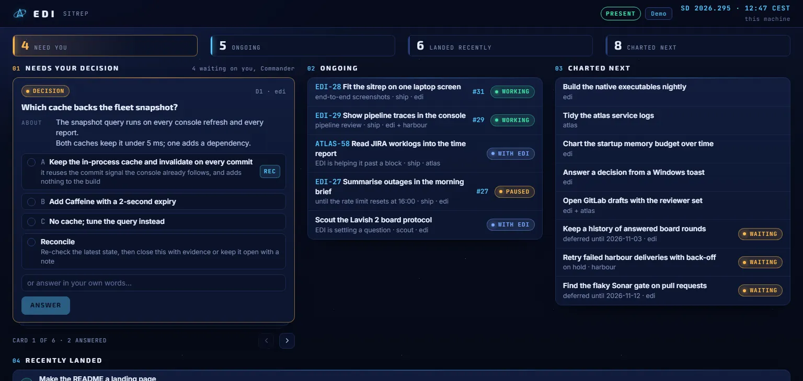

# The console and research boards

## The EDI console

The core serves the EDI console on its own port, in the approved dark skin ([console](decisions/console.md), [console-look](decisions/console-look.md)).
`edi console` opens it in the browser through a link that signs in once, within two minutes, and the session lasts twelve hours ([api-access](decisions/api-access.md)).

```sh
edi console                                         # open the console in the browser, signed in
edi sitrep --board                                  # print the sitrep, then open its page in the console
```

The sitrep page shows what needs the captain, what is ongoing and what is charted next side by side, in one glance on a laptop screen, with what landed this week below them, and follows every change as it happens ([fleet-snapshot](decisions/fleet-snapshot.md), [console](decisions/console.md)).
Each ongoing task leads with its EDI or JIRA work key, shown once even when the title already starts with it, and a task without a key shows its title alone ([fleet-snapshot](decisions/fleet-snapshot.md)).



Every time the page shows is in the machine's own time zone, which the core names in the sitrep document, so the page and the command agree whatever zone the browser is in ([time-zones](decisions/time-zones.md)).
The header clock reads as a stardate, such as "SD 2026.295 · 11:14 CEST", and on a screen 350 CSS pixels wide or narrower it keeps only the time.

Each decision card takes an option, the captain's own words, or both, and records them verbatim as the captain's answer; Reconcile asks the primary to re-check the decision against reality instead of answering it ([captain-decisions](decisions/captain-decisions.md)).
The Personality button in the header opens the personality desk above the sitrep: the Balanced, Plain and Demo presets, a slider from 0 to 10 for each of the nine scales, and a sample of good or bad news worded at the chosen levels ([personality](decisions/personality.md)).
Keep stores the levels exactly as `edi personality` or `/personality` would, so the page and the command always show the same personality; Undo goes back to what is kept.
The console opens through a once-only http address of the console that leads on to the sign-in link, handed to `cmd.exe /c start` from `/mnt/c` on WSL, so Windows' default web browser opens it, and to `xdg-open` on a Linux desktop, so the link never shows in the process list; elsewhere, or when that fails, the command prints the sign-in link instead ([console](decisions/console.md)).

Every new primary session opens the sitrep page in the browser by itself, signed in, as `edi console` does ([console](decisions/console.md)).
It opens once, at the launch of the session that holds the primary role, and not for a standby session, a worker, or the same primary resumed, cleared or compacted.
When the browser cannot open it, the session starts anyway, and its digest names the console's address and `edi console` as the way to open it.
`console.openSitrepAtSessionStart: false` in the machine profile switches it off.

## Research boards

A scout writes its Lavish board in its task's directory, opens it with `lavish-axi`, and has EDI listen to it ([research-boards](decisions/research-boards.md)):

```sh
edi board arm "$EDI_HOME/data/tasks/<task-id>/board.html" --task <task-id> --link <url> --questions 3 --card card.json
```

The link is the one `lavish-axi` printed when the scout opened the board, and the count is how many questions the round puts before the captain ([research-boards](decisions/research-boards.md)).
A decision the board asks is a card on `--card`, in the format `edi decision raise` takes, with `question` naming the board question that answers it: the form's `data-lavish-question`, whose answer data is `{question, answer}`.
EDI raises the card on the scout's task and binds it to the board when it is armed, so the captain's choice there is his word for it, promote included ([research-boards](decisions/research-boards.md)).
`--bind D58,D59` binds decisions the primary raised already, which the board names by number.
The count leaves out the card and the decisions the board binds, which wait as one line each under the board while it listens.
The board waits in the decision zone of the report, the sitrep page and the return brief until a round of the captain's answers arrives; arming it again posts a new round.
When the scout cannot arm it again, the primary posts the round instead:

```sh
edi board post "$EDI_HOME/data/tasks/<task-id>/board.html" --link <url> --questions 2
```

The core runs one `lavish-axi poll` per armed board and starts it again within 30 seconds if it stops ([research-boards](decisions/research-boards.md)).
Each round of feedback becomes one message in the scout's inbox, and a prompt that names a bound decision, in its context data as `decision` or by its card's `question` (with `option` or `answer`), or in words that begin with the decision's number such as `D58 A, ...`, answers that decision as the captain's word ([research-boards](decisions/research-boards.md)).
A board stops listening when the captain ends its session or its task is cleaned up.
